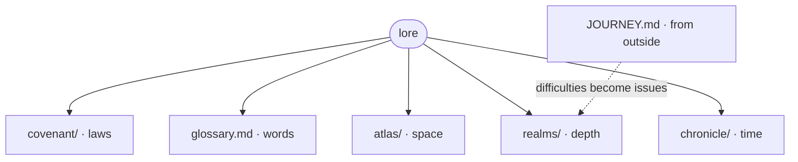
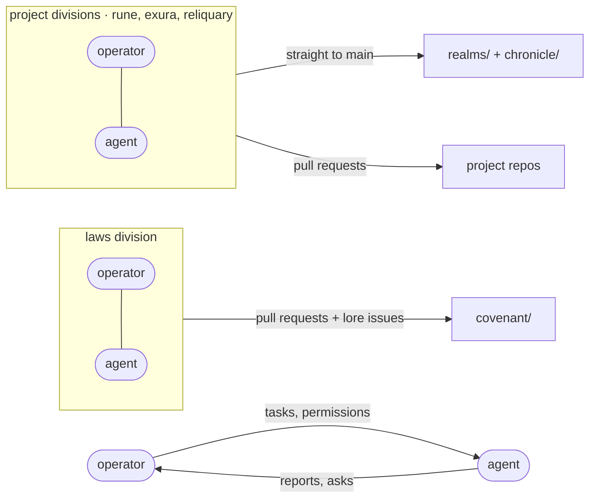
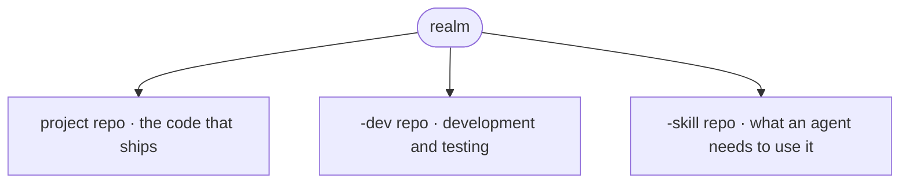
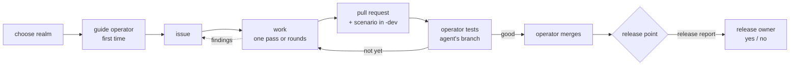

# The Atlas

The map of DEVNEET — diagrams first. Each box gets one line here; its full meaning lives where the link points: words in the [glossary](../glossary.md), rules in the [covenant](../covenant/README.md), depth in the [realms](../realms/README.md), the log in the [chronicle](../chronicle/README.md).

Everything centers on **Rune**, and the same pattern repeats at every scale (fractal): one hub, its branches.

## Lore at a glance

What this repo holds, and the axis each part answers.

- **[covenant/](../covenant/README.md)** — the laws: how work flows, how to chronicle, how to release, how to write a journey, how lore changes.
- **[glossary.md](../glossary.md)** — the vocabulary; the names are load-bearing.
- **atlas/** — these maps.
- **[realms/](../realms/README.md)** — one folder per project: its story and its reference.
- **[chronicle/](../chronicle/README.md)** — the track record of the project divisions, month by month.
- **[journey](../covenant/journey.md)** — `JOURNEY.md`, kept by anyone building *with* a DEVNEET project, in their own repo.

## Who works where

Every agent works for an **operator**, in one **division**.

- The **operator** gives the agent its tasks and permissions, and decides: merging, releasing, crossing into another division ([workflow](../covenant/workflow.md)).
- The **laws division** changes the covenant only by pull request; its record is issues in lore ([changing-lore](../covenant/changing-lore.md)).
- The **project divisions** commit realm docs and chronicle straight to `main`, and change their projects by pull request.

## Repos of a realm

A realm is more than one repo. Each realm's README lists its own in "Working on this realm".

| Realm | Project | `-dev` | `-skill` |
|---|---|---|---|
| rune | `rune` | `rune-dev` | `rune-skill` |
| exura | `exura` · `exuraphp` · `exurajs` · `exuracss` | `exura-dev` | `exuraphp-skill` · `exurajs-skill` · `exuracss-skill` |
| reliquary | `reliquary` · `relic-cli` · `relic-web` | — | `reliquary-skill` |

## The flow

From choosing a realm to a release ([workflow](../covenant/workflow.md), [release](../covenant/release.md)).

## Realms

How the projects relate.

One map per realm:

- [rune.md](rune.md)
- [reliquary.md](reliquary.md)
- [exura.md](exura.md)

---

**Next →** [realms/](../realms/README.md) — the projects in depth.
