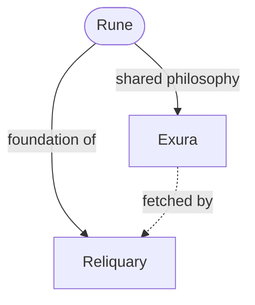

# The Atlas

The map of DEVNEET — diagrams only. Narrative lives in [../realms/](../realms/); the log in [../chronicle/](../chronicle/).

Everything centers on **Rune**, and the same pattern repeats at every scale (fractal): one hub, its branches.

## Map antar realm — org scale

## Per-realm maps — realm scale

- [rune.md](rune.md)
- [reliquary.md](reliquary.md)
- [exura.md](exura.md)
